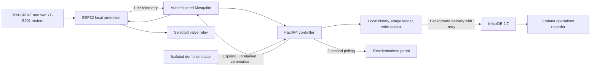

# Architecture and operating assumptions

## What the readings mean

- `flow_lpm` measures tank withdrawal into a delivery branch. `flow_out_lpm` measures water delivered at the far end of that same branch. Their difference estimates loss within that segment.
- Tank refill is not measured in this design. An ETA is a short-term extrapolation of withdrawal, assuming no refill and approximately constant demand. It is neither a guaranteed supply duration nor a learned forecast.
- The volume conversion assumes a tank with constant horizontal cross-sectional area. A horizontal cylindrical tank needs a different calibrated conversion.
- One sensing pair represents one independently metered control domain. Multiple device streams have independent forecasts and leak counters. The software does not aggregate several apartment withdrawals into a shared master-tank model.
- Daily consumption integrates **delivered** `flow_out_lpm` using the trapezoid rule. It splits intervals at midnight in `QUOTA_TIMEZONE` (default Asia/Kolkata), persists totals, and excludes gaps over six seconds. Values therefore represent observed consumption, not a billing-grade meter. The daily allowance is informational; quota exhaustion does not add an undocumented shutoff rule.

## Decisions and priorities

The recent five inlet readings determine predicted withdrawal. Reserve volume is 10% of `TANK_CAPACITY_L`. Available volume is the smaller of reported volume and volume derived from reported level, minus reserve. A low report cannot be overridden by a conflicting high report.

Priority is: reserve closure, sensor fault cap, tank rationing, confirmed branch leak, tank warning, normal supply. `tank_mode` and `flat_status` always preserve both decisions. `mode` shows the highest relevant operator state. Master and flat percentages are **time duty commands**, not proportional valve positions.

Sensor readings below 20 cm, above 600 cm, absent, or explicitly marked faulty produce a fault. Sensor health is normalized before persistence. A reserve indication still takes priority over a sensor fault. Firmware may act sooner than the backend and always applies its own reserve check.

The original table did not specify a valid state for level below 25% with long or infinite ETA. This implementation rations in that case. At exactly 10%, rationing remains possible; below 10%, all commands close. At exactly 60 and 120 minutes, the state changes to warning and normal respectively (unless another condition has priority).

No withdrawal is represented as `eta_minutes: null`, avoiding infinity in JSON. Faulty level sensing also makes ETA null. At zero usable reserve with positive withdrawal, ETA is zero.

The first two excessive differential readings indicate a suspected leak. The third confirms it. An in-balance reading resets the counter. A telemetry gap exceeding six seconds resets both the short forecast and leak debounce so old disconnected readings cannot confirm a new leak.

## Delivery, persistence, and freshness

The service serializes ingestion, updates controller state, persists the reading and daily-use increment in one SQLite transaction, and publishes the command only after persistence succeeds. If persistence fails, the controller state is restored and no command is issued. A single Uvicorn worker owns this process; do not add `--workers` without moving state/locking to shared infrastructure.

Strictly newer timestamps are required for each device. Duplicate and out-of-order frames return HTTP 409 without affecting flow averages, leak counts, or quotas. Readings more than 30 seconds old or five seconds in the future are rejected. A reading older than the six-second freshness threshold can be recorded, but cannot renew a hardware command. Latest responses include `stale` and `age_seconds`.

MQTT accepts only non-retained telemetry with a device ID matching its topic and payloads no larger than 8 KiB. Credentials and broker ACLs restrict each device to its own topics. Commands include a UUID, issue time, and expiration, use QoS 1 and `retain=false`, and expire after ten seconds by default. Firmware rejects expired/replayed commands and closes when a command expires. A queued command is not proof of actuator movement: `valve_percent` in subsequent telemetry reports the edge duty setting. No relay position sensor is provided.

The Influx writer reads the persistent outbox in batches. Successful writes acknowledge only those row IDs. Failed writes retry while the controller and local portal continue. History and pending outbox records are kept for `HISTORY_RETENTION_DAYS` (seven by default); outages beyond that window lose old unexported telemetry. The Influx bucket independently retains 30 days by default. Local quota records follow local history retention.

## Demo isolation

Demo and live mode use different SQLite files. In demo mode, the MQTT bridge may connect for service health but does not subscribe to telemetry or publish commands. Simulator data is tagged `source=demo`; manual API data is `source=api`; physical MQTT data is `source=hardware`. Grafana includes a source selector.

Scenarios are deterministic input fixtures with a small flow ripple. They exercise the actual controller, persistence, API, and portal. They do not simulate full tank physics or valve hydraulics. A simulator reset clears its local device history and quota and stops generation; previously exported Influx history remains available in Grafana.

## Scope limits resolved from the plan

The supplied single-relay pinout cannot independently actuate a master valve and a branch valve. The firmware role selects which command GPIO 25 follows. The portal displays both decisions so the design can be evaluated, but they must not be presented as two installed actuators. Expansion needs a separately designed relay/output topology. The plan mentions pump cutoff but specifies no pump hardware; no pump control is invented.

The hardware guide corrects the plan's wiring sketch, which could be read as connecting both solenoid leads directly to supply negative. It also documents validating ultrasonic reflections in a 40 mm stilling tube, actual sensor blind-zone clearance, appropriate fuse sizing, and relay logic compatibility.

## References used for integration

- [FastAPI lifespan](https://fastapi.tiangolo.com/advanced/events/)
- [Paho MQTT Python callback API and network loop](https://eclipse.dev/paho/clients/python/docs/)
- [InfluxDB Python client and write modes](https://github.com/influxdata/influxdb-client-python)
