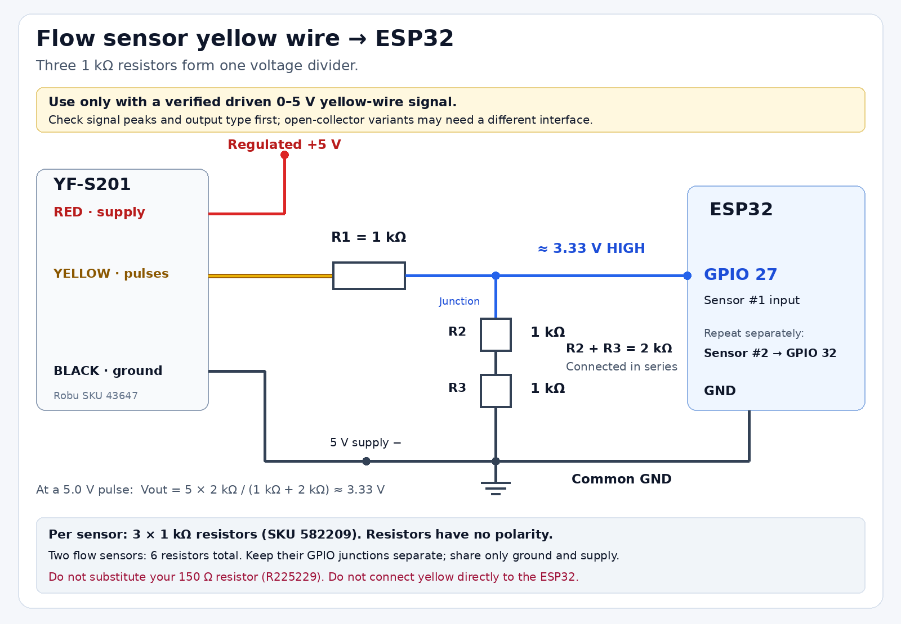

# Hardware connections for the two-tank build

This guide matches the project's **two-tank transfer configuration**: one ESP32, the photographed **AJ-SR04M**, two Robu `43647` flow sensors, one `610733` float switch, one `1121234` two-channel relay module, and one `31396` normally closed valve. GPIO numbers mean the ESP32's printed **GPIO labels**, not header positions. The target is a classic ESP32 Dev Module (`esp32dev`); an ESP32-C3/S3 needs a different pinout.

Use this guide and the current [firmware configuration](../firmware/esp32/include/config.example.h) for this build. The earlier [implementation plan](../implementation_plan.md) describes the original JSN-SR04T/active-low arrangement and is historical where it differs.

## Resolve these before energizing the valve

The listed components can support the sensing and control design, but **they cannot operate this valve safely as supplied**:

1. **The valve needs regulated 12 V DC and is listed at 1 A.** The pictured NIPPO/Hi-Watt rectangular 9 V batteries are not a 12 V source. Two in series give nominal 18 V; two in parallel remain 9 V. Do not connect either arrangement to the valve, relay supply, or ESP32. Their current capability is not established for this load. A battery is not required: a suitable enclosed regulated 12 V DC supply can power the valve.
2. **Robu explicitly says valve `31396` is unsuitable for gravity-fed systems.** Its listed operating pressure is 0.02–0.8 MPa. Two small tanks on a table do not establish a suitable pressure source. Use an arrangement verified to meet the valve's pressure requirement, or obtain a water valve explicitly rated for the actual gravity/zero-pressure conditions. No pump is in the inventory, and the firmware has no pump-control output. Software cannot correct this hydraulic limitation. [Robu valve specifications](https://robu.in/product/dc12v-plastic-electric-12v-water-solenoid-valve-electric-solenoid-valve-magnetic-nc-water-air-inlet-flow-switch-nc-12/)
3. **The resistor values are 1 kΩ and 150 Ω.** `R225229` is a 150 Ω resistor, not 2 kΩ. One of each cannot make the required 5 V pulse divider. Confirm how many 1 kΩ resistors were received; three per divider can make the circuit below. Otherwise additional suitable resistors or verified level interfaces are needed.
4. **A fuse holder is not a fuse, and the capacitor is not a flyback diode.** No actual fuse or valve-coil suppression diode was listed. Add appropriately selected parts before powering the coil. The 6 A holder rating does not specify the fuse to install.
5. **The AJ-SR04M mode and the relay's electrical interface still need checking.** The supplied photograph does not establish the ultrasonic PCB revision/mode, 3.3 V trigger acceptance, or relay input backfeed. Measure/verify the interfaces before attaching ESP32 GPIOs.

`WATER_HARDWARE_COMMISSIONED` defaults to **0**, so the firmware keeps the actuator inhibited while wiring, tank dimensions, power, pressure, and float orientation remain unverified. Setting it to 1 is a commissioning declaration; it does not measure or fix the hardware.

## Where each component goes

The user has identified the **2.5 L tank as the source** and the **1.5 L tank as the receiver**. The AJ-SR04M continuously measures the source tank. The float stops transfer when the receiver reaches its chosen full level. The two flow meters measure the same pipe section before and after the point where a leak may occur.

```text
SOURCE TANK                                    RECEIVER TANK
AJ-SR04M above water                           P35 float at full level
       │                                               │
source outlet                                          │
       ↓                                               │
manual shutoff → NC valve → Flow #1 → monitored pipe → Flow #2 → receiver
                                           │
                                           └→ controlled leak tap → catch tray
```

This is the placement of the components, **conditional on solving the valve pressure requirement above**. Follow all flow arrows. Place the valve upstream of the leak tap so closing it removes supply to both the receiver and the leak. Every normal outlet from the monitored section must pass through Flow #2; an extra outlet between the meters appears as a leak. Keep the pipe full, purge air, and follow the meter's mounting requirements.

There is one controlled water path and one valve. The unused second relay channel does not provide a second valve. The receiver has a **full/not-full switch**, not a continuous percentage or volume measurement. The source tank's ultrasonic reading supplies the existing `level_percent` and `volume_l` values.

The default `WATER_VALVE_ROLE_TRANSFER` applies the **smaller of `master_valve_percent` and `flat_valve_percent`** to this single transfer valve. Thus either a source-tank restriction or the monitored branch's leak restriction can limit transfer. The local float and reserve safeguards take priority. A duty value is a timed on/off command; it is not proportional valve position.

## Verified inventory

These are Robu's seller specifications, checked on 23 October 2026. Generic products can vary; confirm delivered markings and physical measurements. See [the detailed parts notes](parts-research-notes.md) for source caveats.

| Owned part | Verified identity | Use in this build |
| --- | --- | --- |
| Two tanks | Source **2.5 L**, receiver **1.5 L**; source depth reported as **approximately 20 cm** | Confirm usable full/empty distances before calibration |
| One ESP32 | Exact carrier board not identified | USB-powered controller; check its power-path documentation |
| AJ-SR04M and matching probe | Board label visible in the supplied photograph; firmware/mode unverified | Source-tank distance in trigger/echo mode |
| `43647`, two | [YF-S201 black](https://robu.in/product/yf-s201-water-flow-measurement-sensor-with-1-30liter-min-flow-rate-2/), 5–18 V supply, 15 mA maximum at 5 V, rated 1–30 L/min | Pipe input/output flow; initial 450 pulses/L each |
| `1121234` | [5 V two-channel optocoupler relay](https://robu.in/product/2-channel-relay-module-30a-5v-supports-high-and-low-trigger-optocoupler/), high/low trigger selectable, up to 190 mA operating current | Channel 1 switches the valve; channel 2 remains inactive |
| `31396` | [Normally closed 12 V / 1 A water/air valve](https://robu.in/product/dc12v-plastic-electric-12v-water-solenoid-valve-electric-solenoid-valve-magnetic-nc-water-air-inlet-flow-switch-nc-12/), nominal 1/2-inch ports, 0.02–0.8 MPa | Transfer shutoff, only with suitable power and pressure |
| `610733` | [P35 NC plastic float](https://robu.in/product/p35-small-float-level-control-switch-plastic-float-switch/), passive switch, seller switching limit 10 W / 0.5 A | Receiver full-level input; do not switch the valve coil through it |
| `1897057` | [BF-013A fuse holder](https://robu.in/product/fuse-holder-bf-013a/), seller rated 6 A / 250 VAC; package lists holder only | Hold a separately selected fuse; verify cartridge size |
| `582209` | [1 kΩ, 0.25 W, ±1% axial resistor](https://robu.in/product/1k-ohm-0-25w-metal-film-resistor-pack-of-100/) | Divider components if sufficient quantity is available; count actual pieces |
| `R225229` | [MF25 150R, 150 Ω, 0.25 W, ±1%](https://robu.in/product/mf25-150r-multicomp-pro-through-hole-resistor-150-ohm-mf25-series-250-mw-%c2%b1-1-axial-leaded-250-v/) | Not a replacement for a 2 kΩ divider resistor |
| `662929` | [100 nF / 50 V ceramic disc capacitor](https://robu.in/product/100nf-50v-disc-capacitor/) | Optional float-input noise filter or local 5 V supply decoupling |
| `R134067` | [XINYA XY308-2.54-4P terminal](https://robu.in/product/xy308-2-54-xinya-4-pin-screw-terminal-block/), four positions, 2.54 mm pitch, seller rated 6 A | Secure PCB-mounted connections; each terminal is electrically separate |
| Two rectangular 9 V batteries | NIPPO heavy-duty and Hi-Watt 6F22 shown by user | Leave out of this build's power circuit |
| USB supply/power bank | Output/current and power-bank timeout behavior not supplied | ESP32 USB power; verify sustained operation |

The current `582209` page says one resistor in its package body despite “pack of 100” in its URL/title. Do not infer the delivered quantity from the URL. No relay contact rating establishes the rating of the complete wiring, terminal block, or fuse.

## Power distribution

Use **USB only for the ESP32's board power**. Power the AJ-SR04M, both flow sensors, and the relay from a suitable regulated 5 V accessory rail. This may come from an appropriately rated USB supply/distribution arrangement. If it comes from a separate supply, join its **negative/ground** to ESP32 GND; do not join its positive output to the board's USB/5V positive unless the carrier's documented power path permits that arrangement. Budget for the relay's 190 mA maximum, both meters, ultrasonic module, and supply margin. Do not draw relay-coil current from a GPIO or assume the ESP32's 3V3 regulator can provide accessory power.

For a genuine ESP32-DevKitC V4, Espressif specifies one board power source at a time: USB, 5V header, or 3V3 header. Other carrier boards need their own documentation. A power bank may shut off at low load or during operation; verify it stays on through all states. [Espressif board power options](https://docs.espressif.com/projects/esp-dev-kits/en/latest/esp32/esp32-devkitc/user_guide.html#power-supply-options)

The valve has its **own regulated 12 V DC circuit**, sized for its actual continuous/inrush demand. A supply rated at least 1 A is required by the seller's nominal load; provide suitable headroom and verify the delivered coil. Keep mains wiring inside a suitable enclosed supply. The 12 V positive must never touch ESP32, AJ-SR04M, flow-signal, relay VCC, or relay IN terminals.

Relay contacts are mechanical switches: their COM/NO circuit does not need a logic-ground link merely to switch an independently isolated 12 V supply. If a shared converter already connects the 5 V and 12 V grounds, route valve return current directly to the supply, away from sensor grounds. Optocouplers on a jumpered relay board do not by themselves prove isolation of its supply/input circuit.

## Terminal-by-terminal wiring

Disconnect all supplies while wiring. Use printed terminal labels, not the apparent order in a photograph. The AJ's combined TRIG/RX and ECHO/TX labels only represent trigger/echo signals in the supported pulse mode.

| Terminal / wire | Connect to | Important detail |
| --- | --- | --- |
| ESP32 USB | USB supply/power bank or PC during programming | One documented board power source |
| ESP32 GND | Logic ground bus | Common with 5 V accessory negative and all signal interfaces |
| AJ-SR04M VCC | Regulated 5 V accessory rail by default | See the 3.3 V variant exception below |
| AJ-SR04M GND | Logic ground | Keep the module PCB dry |
| AJ-SR04M TRIG/RX | **GPIO 26**, through a suitable upward level interface if required | 20 µs trigger; verify 3.3 V high acceptance first |
| AJ-SR04M ECHO/TX | Interface/divider A input; its output to **GPIO 34** | Never attach an unverified 5 V echo directly |
| Flow #1 red | Regulated 5 V accessory rail | Seller wiring; verify actual part |
| Flow #1 black | Logic ground | Upstream meter |
| Flow #1 yellow | Interface/divider B input; its output to **GPIO 27** | `flow_lpm`; pulse input |
| Flow #2 red | Regulated 5 V accessory rail | Same accessory supply |
| Flow #2 black | Logic ground | Downstream meter |
| Flow #2 yellow | Interface/divider C input; its output to **GPIO 32** | `flow_out_lpm`; pulse input |
| P35 float wire 1 | Logic ground | No external voltage goes to the switch |
| P35 float wire 2 | **GPIO 33** | `INPUT_PULLUP`: closed = LOW/permit, open = HIGH/stop |
| Relay module VCC/DC+ | Regulated **5 V**, as labelled | Not 9 V or 12 V; inspect any separate coil/logic supply terminals |
| Relay control GND/DC− | Logic ground for the qualified interface | Follow the actual board's supply/input scheme |
| Relay IN1 | **GPIO 25 via a verified GPIO-safe interface** | Default HIGH-trigger: LOW off, HIGH on |
| Relay IN2 | **GPIO 23 via the same qualified interface** | Held LOW/off in default HIGH-trigger mode; channel unused |
| Relay channel 1 COM | Fused 12 V positive | Fuse near the 12 V source |
| Relay channel 1 NO | Valve positive | NO means contact open when relay coil is off |
| Relay channel 1 NC | Leave disconnected and insulated | Do not use NC for this valve |
| Relay channel 2 COM/NO/NC | Leave disconnected and insulated | No second actuator |
| Valve negative | 12 V supply negative | Direct coil return |
| Suppression diode cathode/stripe | Valve positive, after NO contact | Across the coil, not in series |
| Suppression diode anode | Valve negative | Select an adequately rated diode |

**Float installation:** mount the P35 in the **1.5 L receiver** below its overflow level, leaving enough spare volume for water already in the pipe and the measured valve-closing delay. With power disconnected, use a continuity meter to arrange it so it is **closed below that safe full limit and open at the limit**. The product is described as NC, but mounting direction and float orientation determine which water position opens it. Confirm the actual movement; do not infer it from “NC.” An unplugged/broken wire then also causes a stop. A shorted cable or stuck float cannot be diagnosed by this two-wire circuit. Keep a safe overflow path and manual shutoff available.

If the single 100 nF capacitor is used as an input filter, connect it **between GPIO 33 and logic ground**, close to the ESP32. Alternatively use it across accessory 5 V and ground near a module. It is non-polarized; choose one location unless more capacitors are available. It does not replace the float recovery debounce, a bulk supply capacitor, or the valve diode.

### Signal voltage conversion

The default 5 V ultrasonic and flow signals require **three separate verified 3.3 V interfaces**. The Robu flow listing does not establish whether the delivered yellow output is actively driven or open collector with a 5 V pull-up. Treat it as potentially 5 V until its circuit/waveform is checked.

The flow-sensor drawing below shows one divider for a **verified driven 0–5 V pulse output**. Build a separate copy for each flow sensor: GPIO 27 for the upstream meter and GPIO 32 for the downstream meter. Sensor black, ESP32 GND, and regulated 5 V supply negative share ground. The signal junctions must remain separate.



[Open the editable/vector circuit diagram](diagrams/flow-sensor-yellow-wire.svg).

For a suitable actively driven 5 V pulse output, the existing 1 kΩ type can make a divider if **nine pieces** are available in total:

```text
sensor signal ── 1 kΩ ──┬── ESP32 input
                         │
                        1 kΩ
                         │
                        1 kΩ
                         │
                    logic ground
```

The two lower 1 kΩ resistors are **in series**, giving 2 kΩ. Nominal output is `5 × 2/(1 + 2) = 3.33 V`. Build A for GPIO 34, B for GPIO 27, C for GPIO 32; never join their midpoints. Use the specified 1% parts and check maximum supply/pulse voltage, tolerances, output current capability, and measured high/low levels before connection. A multimeter may show only the average of a pulse; check peak voltage with appropriate equipment.

**Do not use one 1 kΩ plus one 150 Ω resistor as this divider.** A 150 Ω upper / 1 kΩ lower pair gives about **4.35 V** from 5 V; reversed it gives about **0.65 V**. Neither is suitable. If only one of each resistor was received, the three dividers cannot be built from that inventory.

An open-collector output may instead use a 3.3 V pull-up **only when the actual sensor circuit permits it and has no conflicting internal 5 V pull-up**. A weak pull-up before a 3 kΩ divider can make the high voltage too low. Select the pull-up and interface together; do not assume all YF-S201 variants match. GPIO 34 has no internal pull-up/down, and the firmware leaves the pulse inputs as `INPUT`. [Espressif GPIO restrictions](https://docs.espressif.com/projects/esp-idf/en/stable/esp32/api-reference/peripherals/gpio.html)

Classic ESP32 inputs are not 5 V tolerant. The datasheet specifies the required high input and voltage limits; design for normal 3.3 V operation rather than treating an absolute maximum as a target. [ESP32 electrical limits](https://documentation.espressif.com/esp32_datasheet_en.html)

### Relay trigger mode and startup state

For the default `WATER_RELAY_ACTIVE_HIGH=1`, put **both relay channel trigger selectors in HIGH mode** before attaching GPIOs. Firmware drives GPIO 25 LOW for closed/off and HIGH for open/on; GPIO 23 stays LOW to disable the unused channel.

The [seller's trigger chart](https://robu-prod-media.s3.ap-south-1.amazonaws.com/product-descriptions/2021/11/1121234-1.jpg) lists the 5 V board's HIGH mode as ON at 3.3–5 V and OFF at 0–2.5 V. That is a seller threshold claim, not a verified input schematic. Nominal 3.3 V is its minimum stated ON level, and input current, pull-ups, and backfeed are unspecified. **Do not interpret this chart as permission to connect a 5 V pull-up to an ESP32 pin.** Qualify the input or use an appropriate driver with a GPIO-safe 3.3 V side.

The hardware interface must keep **both channels off** during reset, startup, flashing, and removal of ESP32 power while accessory 5 V remains on. For HIGH mode this requires a suitable off/LOW bias at the module input; its exact circuit must suit the module and driver. Verify it with the valve disconnected. Firmware's startup write cannot control a GPIO before firmware begins running.

The optional `WATER_RELAY_ACTIVE_HIGH=0` setting supports an appropriately designed LOW-trigger interface: set **both module selectors LOW**, use HIGH for off/LOW for on, and ensure the interface's power-off bias remains inactive. Changing software polarity alone without changing the physical trigger selectors and startup bias is incorrect. If an interface inverts logic, account for its truth table when configuring and testing the complete path.

### Valve power circuit

```text
12 V positive ── selected fuse ── relay CH1 COM
                                    relay CH1 NO ── valve (+)
                                                    [ COIL ]
12 V negative ────────────────────────────────────── valve (−)

Diode directly across valve coil:
  stripe/cathode → valve (+), after relay NO
  anode         → valve (−)
```

The normally closed **water valve** and normally open **relay contact** serve different roles: removing relay power opens the electrical contact, removing valve-coil power and closing the water path. Check actual shutoff under the intended fluid pressure; a click alone does not establish flow or closure.

Select the actual fuse from measured coil current/inrush, wire/connector ampacity, and the supply's fault capability. The holder's 6 A label is a maximum holder rating, not a recommendation for a 6 A fuse. Verify the cartridge fits. Select coil suppression for current, reverse voltage, energy, and repetitive operation; a proposed 1N4007 must be checked against those conditions. A diode affects coil-current decay/closing time. The relay's own coil diode, if fitted, does **not** suppress the separate water-valve coil. Confirm DC inductive-load contact ratings and valve duty/temperature limits. Keep coil wires away from pulse inputs.

## AJ-SR04M mode, mounting, and calibration

The supplied photo says **AJ-SR04M**, so the project uses that identity. It must operate in **trigger/echo pulse-width mode**, not automatic UART distance output. In the original AJ-SR04M manual this is the mode with **R19 open**. PCB revisions differ: inspect the reverse side and the documentation for the delivered version before altering pads/resistors. Do not solder, bridge, or remove a component based only on the front photograph. [Original AJ-SR04M manual](https://altronics.cl/uploads/manual-aj-sr04m.pdf); see [the project's sensor research notes](aj-sr04m-research-notes.md) for revision differences.

The firmware sends a **20 µs trigger every 120 ms**, captures echo edges without a long blocking measurement, and uses a median of five valid samples. Its conservative accepted range is **30–300 cm**; this is the project's operating envelope, not a universal rating for every AJ-SR04M variant. An echo outside that range is a fault.

Default power is 5 V with an echo interface. If the exact delivered AJ board is positively identified as rated for **3.3 V operation**, its measured output is GPIO-safe, and its operating behavior is validated at that supply, 3.3 V power/direct echo may be used for that board. In that case do **not** add a divider intended for a 5 V echo, which could reduce the high level too far. This exception applies to the identified ultrasonic board, not to the 5 V YF-S201 supply or relay. Verify TRIG compatibility at whichever supply is used: the manufacturer-authored Mangze V2 manual specifies a high of at least `0.7 × VCC`, which is 3.5 V at a 5 V supply, so a direct 3.3 V trigger is not guaranteed for that revision. Use a suitable non-inverting upward level interface when required.

Mount the probe vertically above the source water, with its face at least **30 cm above the highest usable/full surface**, or farther if the delivered module's blind zone requires it. The empty distance must remain at or below 300 cm. Keep the acoustic path clear of tank walls, narrow tubes, fittings, foam, condensation, and turbulent surfaces. The small 2.5 L tank may not provide enough beam clearance at this mounting distance; verify the actual opening and full range instead of assuming that a waterproof probe will measure a small tank reliably. The probe being waterproof does not make the PCB waterproof: keep electronics and terminals in a dry enclosure. A narrow stilling tube from the older plan requires acoustic validation before use.

**The source capacity is 2.5 L, receiver capacity is 1.5 L, and source depth is approximately 20 cm, as reported by the user.** The configuration uses `WATER_TANK_USABLE_HEIGHT_CM=20.0f` as an approximate starting value requiring measurement. A 30 cm probe standoff gives full distance 30 cm, empty distance 50 cm, and the 10% reserve boundary at 48 cm. These are calculated setup examples, not confirmed acoustic readings. Commissioning remains disabled until the physical checks pass. The earlier 200 L / 150 cm geometry is historical and must not be reused. Measure the source tank:

- `D_full`: distance from probe face to highest usable water surface.
- `D_empty`: distance from the same face to the defined zero-usable-volume level.
- Standoff = `D_full`; usable height = `D_empty − D_full`.
- Usable capacity = measured volume between those levels.

The linear distance-to-volume calculation assumes a constant cross section. Horizontal cylinders and irregular tanks need a suitable calibration curve; a valid distance is not proof that a linear volume is correct. Test distances at full, intermediate, and empty levels in the actual installation before enabling actuation.

## Firmware settings for this rig

Copy [config.example.h](../firmware/esp32/include/config.example.h) to the ignored `firmware/esp32/include/config.h`. Set actual credentials and physical values there. Old private configurations receive fallback defaults from [hardware_config.h](../firmware/esp32/include/hardware_config.h); review all settings when reusing one.

| Setting | Required choice / measurement | Shipped default |
| --- | --- | --- |
| `WATER_HARDWARE_COMMISSIONED` | Set to 1 only after the physical checklist passes | **0: actuation inhibited** |
| `WATER_VALVE_ROLE` | `WATER_VALVE_ROLE_TRANSFER` for the single source-to-receiver path | Transfer, value 3; minimum master/flat command |
| `WATER_RELAY_ACTIVE_HIGH` | Match both physical trigger selectors and the qualified interface | 1; HIGH selectors, LOW off |
| `WATER_FLOAT_ROLE` | `WATER_FLOAT_ROLE_RECEIVER_FULL` with float in receiver | Receiver full |
| `WATER_FLOAT_RECOVERY_MS` | Continuous closed/permit time required after float stop | 500 ms |
| `WATER_TRIGGER_PULSE_US` | Pulse trigger supported by the identified AJ mode | 20 µs |
| `WATER_SENSOR_MIN_CM` / `WATER_SENSOR_MAX_CM` | Project distance validation bounds | 30 / 300 cm |
| `WATER_PROBE_STANDOFF_CM` | Actual probe-face-to-full-water distance | 30 cm example; meet the greater physical blind-zone requirement |
| `WATER_TANK_USABLE_HEIGHT_CM` | Actual `D_empty − D_full`; verify the reported approximation | **20.0 cm: approximate** |
| `WATER_TANK_CAPACITY_L` | Source usable capacity; check usable fill volume | **2.5 L** |
| `WATER_RECEIVER_CAPACITY_L` | Receiver capacity; float limit must leave overflow margin | **1.5 L** |
| `WATER_FLOW_IN_PULSES_PER_LITRE` | Calibrated upstream pulse count per litre | 450 initial estimate |
| `WATER_FLOW_OUT_PULSES_PER_LITRE` | Calibrated downstream pulse count per litre | 450 initial estimate |

Set backend `TANK_CAPACITY_L` to the same **2.5 L source** usable capacity and firmware `WATER_RECEIVER_CAPACITY_L` to **1.5 L**, then adjust usable capacity if calibration establishes a smaller working volume. The nominal 10% source reserve is **0.25 L**. Do not enter the sum of both tanks as the ultrasonic tank capacity. Until the approximate 20 cm usable depth and mounting are calibrated and commissioning is confirmed, a source percentage/volume is uncalibrated and must not be treated as a measurement. The optional `WATER_FLOAT_ROLE_SOURCE_LOW` describes a float deliberately installed as source-low protection; selecting it does not leave a receiver-full switch elsewhere in the system. The physical input always requires closed/LOW to permit operation; there is no software bypass for an absent float.

For each flow meter, close the leak tap and collect measured water volumes within its supported 1–30 L/min range. Start at 450 pulses/L from Robu's `f = 7.5 × Q` formula, then calibrate separately: `K_new = counted_pulses / collected_litres`. If using reported flow, `K_new = K_old × reported_litres / collected_litres`, with reported litres integrated over actual elapsed time. Repeat across several volumes/rates. Flow below the listed 1 L/min minimum may be unreliable or fail to turn the turbine; code cannot extend the physical meter rating. The seller also states approximately 2.25 mL/pulse, so neither that approximation nor the initial coefficient replaces calibration. Check balance over complete duty cycles as well as steady flow.

Set Wi-Fi, the broker's reachable LAN address, device identity, MQTT credentials, and time synchronization as described in [firmware/README.md](../firmware/README.md). Start the backend in live-hardware mode to prevent simulator readings from competing with the device. Use the build/upload procedures in that file or [the Windows guide](https://github.com/TrijalBurman/Water-Rationing-System/blob/windows/docs/windows.md).

## Local stop behavior

- Before commissioning, before a valid source-level median, or without a live command/valid clock, the actuator stays off.
- An **open float circuit immediately stops transfer locally**. Normal contact must then remain closed for 500 ms, and a **new command issued more than two seconds after recovery** is required before reopening (the margin covers allowed clock skew). Closing the float alone does not replay the previous opening command. This continues independently of network work.
- The first credible raw source-level reading below 10% closes the valve without waiting for the median or backend. Reopening requires the source-level safeguards and live command to permit it.
- Invalid echo resets the median window, retains the last trusted level, and caps an otherwise permitted command at 30%; a previous reserve stop remains effective. A sensor that never established a trusted level cannot open the valve. The fault cap cannot prove that the source still contains reserve water.
- A 30-second duty period implements partial commands: 25% means 7.5 seconds energized per period, not a guaranteed 25% water flow. Verify suitability for coil heating, pressure changes, and water hammer. Do not assume arbitrary fast cycling is safe.
- Commands expire at their UTC expiry or after 10 seconds without replacement, whichever occurs first. Stale/replayed commands are rejected. Loss of communication can therefore leave the current permitted command active only within that bound; local float/reserve closure still takes priority.

No software test verifies an unplugged hose, a mechanically stuck valve, a shorted float cable, inadequate pressure, or an overheating coil. The receiver float is an input to firmware rather than an independently wired safety controller.

## Physical commissioning checklist

Keep `WATER_HARDWARE_COMMISSIONED=0` for all initial dry checks. The software build passing is not a substitute for these measurements.

1. **Unpowered inspection:** confirm source/receiver designation, labels, polarity, grounds, valve COM/NO wiring, unused contact insulation, correctly fitted fuse, and diode orientation. With disconnected electronics, each example divider measures nominally 3 kΩ from signal to ground and 2 kΩ from midpoint to ground. There must be no wire shorting switched positive directly to negative.
2. **Logic power and interfaces:** verify accessory 5 V, ESP32 3.3 V, actual pulse peaks/high/low levels, and relay input current/backfeed. Leave valve power disconnected. Test both relay channels through reset, flashing, USB loss, and accessory-power sequencing: both must remain off until permitted. Check the power bank does not time out.
3. **Float:** confirm continuity below full and opening at full. Check the displayed stop state with a raised float and an unplugged cable. Verify recovery requires continuous closed contact for 500 ms and a new command. Recheck installed orientation; do not rely on an NC label alone.
4. **Ultrasonic:** identify the AJ mode/revision, then compare distances with a ruler at the minimum clearance, middle, and actual empty distance. Check no-echo and out-of-range faults. Repeat with the actual tank/mounting and representative surface movement. Enter measured source geometry/capacity and rebuild.
5. **Valve supply and hydraulics:** establish a suitable 12 V supply, current protection, suppression, and pressure-compatible valve arrangement. With the water controlled and overflow contained, test energized opening and de-energized/power-loss closure. Measure current/temperature and verify flow in the correct direction. An audible relay click does not establish safe valve operation, and the 9 V batteries are not a substitute for the required supply.
6. **Enable deliberately:** after the preceding checks pass, set commissioning to 1, rebuild/flash, and issue fresh commands. Verify receiver-full and unplugged-float stops close the valve; clear them and confirm an old command cannot reopen it. Test source reserve closure with the actual calibrated geometry, including during Wi-Fi/broker outages.
7. **Calibrate and demonstrate leakage:** collect known volumes through each meter, calibrate, then introduce a controlled leak **between** them. The backend's difference threshold is `max(0.3 L/min, 15% of upstream flow)` for three consecutive readings. In transfer role the smaller master/flat restriction controls the single valve. Low flows and valve transitions need physical validation; a one-pulse difference in a one-second window at 450 pulses/L is about 0.133 L/min.
8. **Failure and recovery:** stop backend commands and verify closure within 10 seconds or the shorter expiry. Test stale retained commands, device reboot, float disconnection, sensor fault, accessory loss, ESP32 power loss, and valve supply loss separately. Confirm recovery only when all applicable local conditions and a new valid command permit it. Recheck overflow containment and manual shutoff before any unattended use.

## Verification status

**No bench electrical, acoustic, relay, battery-load, or wet hydraulic measurements have been performed in this workspace.** The supplied photographs and seller pages identify parts; they do not establish a commissioned installation. Current software checks and compilation results belong in [firmware/BUILD_STATUS.md](../firmware/BUILD_STATUS.md).

Further primary references: [ESP32 Series datasheet](https://documentation.espressif.com/esp32_datasheet_en.html), [DevKitC V4 power guidance](https://docs.espressif.com/projects/esp-dev-kits/en/latest/esp32/esp32-devkitc/user_guide.html), and [Vishay 1N4001–1N4007 datasheet](https://www.vishay.com/docs/88503/1n4001.pdf). Use the actual delivered module's documentation where generic seller claims or PCB revisions differ.
