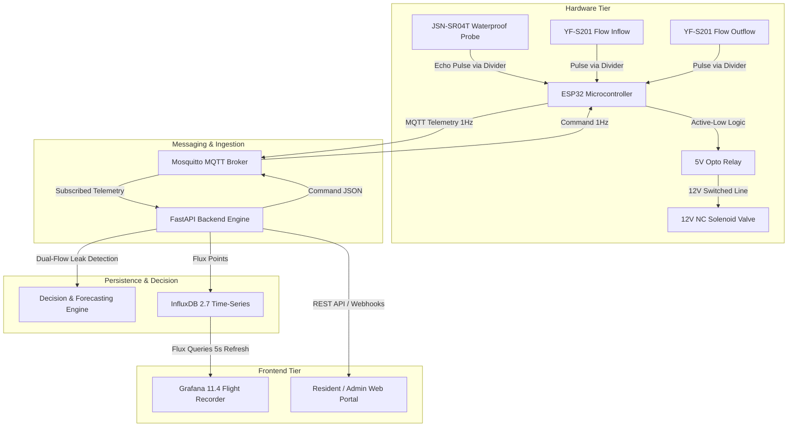

# Complete System Implementation Plan: Hardware, Backend, and Frontend

> **Historical design plan.** This document preserves the original proposal and contains proposed features and part assumptions that differ from the delivered implementation. Use the [hardware connections and commissioning guide](docs/hardware.md), [firmware guide](firmware/README.md), and [architecture notes](docs/architecture.md) for the implemented system. The schematic in section 1.4 has been corrected; the remaining plan is retained as historical context.
>
> **Implemented hardware:** one active-low relay on GPIO 25 controls **either** the master valve **or** one flat valve, as selected in firmware. There is **no pump-control output** and no independently wired second valve channel. Separate master/flat command fields do not add physical outputs. Additional actuation requires an explicitly designed hardware and firmware expansion. Verify sensor/module revision, logic levels, ratings, calibration, and the actual assembled circuit using the current hardware guide.

An end-to-end engineering blueprint from scratch for building the **AI-Powered Smart Water Management and Rationing System**. This plan covers three decoupled tiers: **Hardware Connections (strictly using the JSN-SR04T sensor)**, **Backend Decision Engine**, and **Frontend Flight Recorder & User Interface**.

---

## Architecture Overview



---

## 1. Hardware Connections Implementation Plan (Strictly JSN-SR04T)

### 1.1 Sensor Characteristics & Physical Geometry
The **JSN-SR04T (V2.0/V3.0)** uses an industrial-grade sealed piezoelectric transducer designed for wet, steamy, and splashing environments.
* **Transducer vs. Board**: The transducer probe and 2.5m cable are **IP67 waterproof**. The transmitter/receiver PCB module is **NOT waterproof** and must be housed in a dry external IP65 enclosure.
* **Blind Zone Issue (Critical)**: The physical transducer ringing prevents detecting objects closer than **20 cm to 25 cm**. Any water level entering this blind zone will produce erroneous reflections (jumping to 600+ cm or erratic values).
* **Mechanical Solution**:
  1. Mount the probe on a **vertical riser standoff pipe / collar (25 cm height)** above the maximum allowable water level ($H_{\text{max}}$).
  2. Install an open-ended **40 mm PVC Stilling Tube** vertically inside the tank beneath the probe with 4–5 mm holes drilled at the bottom. This eliminates surface ripples, turbulence, and bubbles from water entering the tank.
* **Operating Mode**: Use standard **Mode 0** (Trigger/Echo pulse mode, identical pulse interface to HC-SR04). Ensure resistor pad R27 on the PCB remains unsoldered/open.

---

### 1.2 Electrical Requirements & Logic Level Shifting
The ESP32 uses **3.3V logic** (maximum 3.6V tolerant). The JSN-SR04T board requires **5V VCC** for proper acoustic pulse transmission, and its Echo output emits a **5V square pulse**.
> [!CAUTION]
> Connecting the JSN-SR04T Echo pin or the 5V YF-S201 pulse outputs directly to ESP32 GPIOs will permanently damage or burn out the microcontroller's internal input diodes. You **must** implement passive voltage dividers.

#### Voltage Divider Equation:
$$V_{\text{out}} = V_{\text{in}} \times \frac{R_2}{R_1 + R_2} = 5.0\text{V} \times \frac{2000\,\Omega}{1000\,\Omega + 2000\,\Omega} = 3.33\text{ V}$$

* $R_1 = 1.0\text{ k}\Omega \ (1/4\text{W}, 1\%)$
* $R_2 = 2.0\text{ k}\Omega \ (1/4\text{W}, 1\%)$ (or two $1\text{ k}\Omega$ resistors in series)

---

### 1.3 Complete Hardware Pinout Matrix

| Component | Pin / Terminal | Connects To | Voltage / Level | Purpose |
| :--- | :--- | :--- | :--- | :--- |
| **JSN-SR04T** | VCC | 5V Power Rail | 5.0V DC | Power supply for transducer pulses |
| | GND | Common GND | 0V | Ground reference |
| | TRIG | ESP32 GPIO 26 | 3.3V Logic Out | $10\,\mu\text{s}$ trigger pulse from ESP32 |
| | ECHO | Divider Input ($R_1$) | 5.0V Pulse Out | Transmit echo return to voltage divider |
| **Echo Divider**| Node between $R_1$ & $R_2$ | **ESP32 GPIO 34** | **3.33V Logic In** | Scaled safe return pulse (GPIO 34 is input-only) |
| **YF-S201 #1 (Inflow)** | Red | 5V Power Rail | 5.0V DC | Hall sensor supply |
| | Black | Common GND | 0V | Ground reference |
| | Yellow (Signal)| Divider Input ($R_1$) | 5.0V Pulse Out | $450\text{ pulses/L}$ frequency train |
| **Flow 1 Divider**| Node between $R_1$ & $R_2$ | **ESP32 GPIO 27** | **3.33V Logic In** | Scaled interrupt line for $Q_{\text{in}}$ |
| **YF-S201 #2 (Outflow)**| Red | 5V Power Rail | 5.0V DC | Hall sensor supply |
| | Black | Common GND | 0V | Ground reference |
| | Yellow (Signal)| Divider Input ($R_1$) | 5.0V Pulse Out | $450\text{ pulses/L}$ frequency train |
| **Flow 2 Divider**| Node between $R_1$ & $R_2$ | **ESP32 GPIO 32** | **3.33V Logic In** | Scaled interrupt line for $Q_{\text{out}}$ |
| **Relay Module** | VCC | 5V Power Rail | 5.0V DC | Optocoupler & coil power |
| | GND | Common GND | 0V | Ground reference |
| | IN1 | **ESP32 GPIO 25** | 3.3V Logic Out | Active-Low valve control signal |
| | COM | 12V Supply (+) through 1A Fuse | 12.0V DC | Switched positive power line |
| | NO (Normally Open)| Solenoid Positive Wire | 12.0V DC (Switched) | Contact open when relay is off; normally closed water valve closes |
| **12V Solenoid** | Negative Wire | 12V Power Supply (-) | 0V DC | Return path to 12V supply |
| | Flyback Diode (1N4007) | Antiparallel across Solenoid | Reverse-biased | Cathode (stripe) to 12V (+); Anode to GND |

---

### 1.4 Corrected simplified wiring schematic

This replaces the earlier illustration, which incorrectly joined switched positive to the negative rail and made the trigger path appear connected to ground. Use the [complete connection table and commissioning checks](docs/hardware.md) for assembly. GPIO labels below are ESP32 GPIO numbers, not physical header positions.

```text
LOGIC / SENSORS
Regulated 5V --> JSN-SR04T VCC; Flow #1 VCC; Flow #2 VCC
Logic GND ----> ESP32 GND; all sensor GNDs; all divider lower ends

ESP32 GPIO 26 --> JSN-SR04T TRIG (3.3V trigger; translate if module requires)
JSN-SR04T ECHO --> divider A input; divider A output --> GPIO 34
Flow #1 signal --> divider B input; divider B output --> GPIO 27
Flow #2 signal --> divider C input; divider C output --> GPIO 32

Each of A, B, and C is a SEPARATE divider for a compatible 5V output:
Sensor signal -- R1 1kΩ --+-- output to its assigned GPIO
                          |
                          R2 2kΩ
                          |
                          Logic GND

RELAY CONTROL (one physical channel)
ESP32 GPIO 25 --> 3.3V-compatible active-low interface --> relay IN1
Relay supply --> its rated supply (normally 5V)
Relay control GND --> logic GND for the non-isolated interface
LOW = relay energized / water valve open
HIGH = relay inactive / water valve closed

12V WATER-VALVE CIRCUIT
12V (+) -- correctly rated fuse -- relay COM
                                  relay NO -- solenoid (+)
                                              [ COIL ]
12V (-) ------------------------------------- solenoid (-)
Relay NC: unused

Flyback diode mounted directly across the coil:
  cathode (striped end) --> solenoid (+), the switched positive node
  anode                --> solenoid (-), 12V negative
There is NO direct wire between switched positive and 12V negative.
```

The dividers require verified output drive/high levels; open-collector flow-meter variants need an appropriate pull-up/level interface as described in the hardware guide. Do not join the three divider outputs. A relay interface must keep the valve closed during reset and loss of ESP32 power. Choose fuse, diode, relay DC inductive-contact rating, wire, and supply capacity for the actual coil; the original plan's 1A fuse and 1N4007 are not universal selections. Power the ESP32 according to its board's instructions and keep 12V away from all ESP32 pins. Both flow sensors belong on the same outgoing branch with the controlled test leak between them.

---

### 1.5 Edge Firmware Architecture (`firmware/esp32`)
1. **Sampling Loop (1 Hz)**:
   * Median filter over 5 consecutive ultrasonic samples to reject spurious outliers or echoes off tank sidewalls.
   * Calculate effective distance: $\text{Distance}_{\text{effective}} = \text{Distance}_{\text{median}} - \text{Offset}_{\text{standoff}}$.
   * Compute tank volume and percentage:
     $$\text{Level}_{\%} = \operatorname{clip}\left(\frac{\text{Distance}_{\text{empty}} - \text{Distance}_{\text{effective}}}{\text{Distance}_{\text{empty}} - \text{Distance}_{\text{full}}} \times 100,\ 0,\ 100\right)$$
2. **Autonomous Reserve Failsafe**:
   * If $\text{Level}_{\%} < 10\%$, immediately set GPIO 25 HIGH (relay de-energized, valve closed) regardless of WiFi, MQTT, or cloud connection.
3. **Duty Cycle Valve Rationing Engine**:
   * For non-proportional ON/OFF solenoid valves, rationing is achieved using a **30-second duty cycle**:
     $$T_{\text{open}} = 30\text{ s} \times \frac{\text{valve\_percent}}{100}$$
4. **Sensor Fault Handling**:
   * Distance $< 20\text{ cm}$ (blind zone breach) or $> 600\text{ cm}$ or no echo pulse triggers `sensor_status = "fault"` and caps flow to a safe $30\%$ limit.

---

## 2. Backend Implementation Plan (FastAPI, InfluxDB, Mosquitto Engine)

### 2.1 Microservice Topology & Docker Stack
* **Language & Runtime**: Python 3.12-slim
* **Web Framework**: FastAPI + Uvicorn (ASGI)
* **Message Broker**: Eclipse Mosquitto 2.0 (MQTT protocol with authenticated ACLs)
* **Time-Series Database**: InfluxDB 2.7 (Flux query support, high-resolution retention)
* **Data Flow**:
  1. ESP32 publishes telemetry JSON to `watertank/{device_id}/telemetry`.
  2. Paho-MQTT bridge in FastAPI receives and parses payload into Pydantic models.
  3. Controller executes forecasting and leak detection algorithms.
  4. Decision is written asynchronously to InfluxDB 2.7.
  5. Actuation command is published back to `watertank/{device_id}/command`.

---

### 2.2 Mathematical Decision & Control Algorithms

#### Algorithm A: Time-to-Reserve Depletion Forecasting
Predicts time remaining before water level hits the critical $10\%$ protected reserve volume ($V_{\text{reserve}}$):
$$\overline{Q} = \frac{1}{N}\sum_{i=0}^{N-1} Q_{\text{in}}[i] \quad (N = 5\text{ rolling samples})$$
$$\text{ETA}_{\text{minutes}} = \frac{V_{\text{current}} - V_{\text{reserve}}}{\overline{Q}}$$

| System State | Condition | Master Valve % | System Behaviour |
| :--- | :--- | :--- | :--- |
| `NORMAL` | $\text{ETA} \ge 120\text{ min}$ and $\text{Level} \ge 25\%$ | $100\%$ | Unrestricted flow; baseline operation |
| `WARNING` | $60\text{ min} \le \text{ETA} < 120\text{ min}$ | $100\%$ | Supply alert; prep for rationing |
| `RATIONING` | $\text{ETA} < 60\text{ min}$ and $\text{Level} \ge 10\%$ | $\max(20\%,\ \text{Level}_{\%})$ | Dynamic duty-cycle throttling |
| `CRITICAL` | $\text{Level} < 10\%$ (Protected Reserve) | $0\%$ | Valve locked closed; dry-run pump cutoff |
| `SENSOR_FAULT`| Invalid Echo ($<20\text{ cm}$ or $>600\text{ cm}$) | $30\%$ | Conservative fallback throttle |

#### Algorithm B: Dual-Flow Mass Conservation Leak Isolation
Monitors the volumetric differential across the branch delivery segment:
$$\Delta Q = Q_{\text{in}} - Q_{\text{out}}$$
$$\text{Threshold} = \max(0.3\text{ L/min},\ 0.15 \times Q_{\text{in}})$$

1. **Transient Debouncing**:
   * If $\Delta Q > \text{Threshold}$ for 1 or 2 consecutive cycles $\rightarrow$ `flat_status = SUSPECTED_LEAK` (Debounce state; no premature valve shutdown due to pipe air pockets or turbine inertia).
   * If $\Delta Q > \text{Threshold}$ for 3 consecutive cycles $\rightarrow$ `flat_status = LEAK_ALERT` (Confirmed leak).
2. **Decoupled Actuation**:
   * Breached flat valve is throttled to **$25\%$ emergency flow**.
   * Master Tank Valve remains **$100\%$ open** (unless tank ETA requires rationing), ensuring other flats are not starved of water.
3. **Safety Priority Override**:
   * If $\text{Level} < 10\%$, `CRITICAL` mode overrides leak throttling and forces all valves to $0\%$.

---

### 2.3 Schemas & API Endpoints

#### Pydantic Data Contracts:
* `Telemetry`: `device_id`, `flat_id`, `timestamp`, `level_percent`, `volume_l`, `flow_lpm`, `flow_out_lpm`, `ultrasonic_distance_cm`, `sensor_status`, `valve_percent`.
* `Decision`: `mode`, `tank_mode`, `flat_status`, `master_valve_percent`, `flat_valve_percent`, `predicted_flow_lpm`, `eta_minutes`, `leak_detected`, `leak_rate_lpm`, `priority`, `reason`.

#### REST API Routes:
* `POST /telemetry`: Ingests simulated or manual telemetry and returns controller decision.
* `GET /health`: System heartbeat and MQTT connection state.
* `GET /devices/{device_id}/latest`: Returns the most recent telemetry frame and decision.

---

## 3. Frontend Implementation Plan (Flight Recorder & UI)

### 3.1 Two-Tier Architecture Strategy
1. **Tier 1: Operations Flight Recorder (Grafana 11.4)**: Real-time high-density analytics for system operators, project evaluators, and engineers.
2. **Tier 2: Resident Portal (Responsive Web UI)**: Lightweight mobile/desktop dashboard for apartment residents to monitor daily consumption, quota remaining, and leak alerts.

---

### 3.2 Tier 1: Grafana 11.4 Dashboard Specification
The Grafana dashboard (`water-rationing.json`) connects to InfluxDB via Flux queries with a 5-second auto-refresh rate:

| Panel ID | Panel Title | Visualization Type | Query / Metric Displayed | Color Thresholds |
| :---: | :--- | :--- | :--- | :--- |
| **1** | Tank Water Level | Gauge Panel | `r._field == "level_percent"` | Green $>50\%$, Yellow $25-50\%$, Orange $10-25\%$, Red $<10\%$ |
| **2** | Usable Water Volume | Stat Panel | `r._field == "volume_l"` with protected reserve marker ($20\text{L}$) | Blue gradient |
| **3** | Dual Flow Mass Balance | Time Series | Overlay of $Q_{\text{in}}$ (Inflow) vs $Q_{\text{out}}$ (Outflow) | Inflow = Cyan, Outflow = Orange |
| **4** | Pipeline Leak Differential | Time Series + Threshold | $\Delta Q = Q_{\text{in}} - Q_{\text{out}}$ with horizontal threshold line ($0.3\text{ L/min}$) | Normal = Green, Alert = Red |
| **5** | Depletion ETA | Stat Panel | `r._field == "eta_minutes"` with sparkline trend | Red $<60\text{m}$, Orange $<120\text{m}$, Green $>120\text{m}$ |
| **6** | Valve Actuator Commands | Bar Gauge | Master Valve % vs Flat 101 Valve % side-by-side | Full = Green, Throttled = Orange, Closed = Red |
| **7** | Flight Mode Indicator | State Timeline | Discrete states: `NORMAL`, `WARNING`, `RATIONING`, `CRITICAL`, `LEAK_ALERT` | Categorical palette |
| **8** | Sensor Health & Echo Distance | Time Series / Stat | JSN-SR04T raw distance in cm + `sensor_status` (`ok` / `fault`) | Fault = Blinking Red |

---

### 3.3 Tier 2: Resident / Admin Web Portal (Implementation Roadmap)
A clean, lightweight frontend hosted directly via FastAPI static mount (`/frontend`) or a separate lightweight client:
* **Technology**: HTML5, TailwindCSS (via CDN), Alpine.js / Vanilla ES6, Server-Sent Events (SSE) or 2-second polling to `/devices/tank-01/latest`.
* **Resident Views**:
  * **Quota Ring**: Circular progress bar showing daily water allowance consumed vs remaining.
  * **Live Leak Banner**: High-priority alert banner ("Warning: Irregular flow differential detected in your branch. Valve throttled to 25% to prevent flooding.").
  * **Community Tank Status**: High-level indicator ("Complex Tank: Normal", "Rationing in Effect: 45 min reserve remaining").

---

## 4. Verification & Testing Plan

### 4.1 Automated Backend Unit Tests (`pytest`)
Execute the full test suite verifying mathematical consistency and state machine debounce logic:
```bash
pytest
```
* `test_normal_level_is_normal`: Verifies 100% valve opening at normal volume and balanced flow.
* `test_low_level_always_closes_valve`: Verifies level $<10\%$ forces 0% valve.
* `test_short_eta_rations_flow`: Verifies ETA $<60\text{ min}$ activates rationing throttling.
* `test_invalid_ultrasonic_reading_is_sensor_fault`: Verifies distance $<20\text{ cm}$ triggers `SENSOR_FAULT`.
* `test_transient_flow_discrepancy_is_debounced`: Verifies 1 and 2 cycles of flow difference do not prematurely trigger alerts.
* `test_sustained_differential_triggers_flat_leak_alert_while_tank_remains_normal`: Verifies 3-cycle debounce locks `LEAK_ALERT` and throttles flat to 25% while tank remains 100%.
* `test_critical_reserve_overrides_leak_throttle`: Verifies tank $<10\%$ overrides leak throttle and shuts valve completely.
* `test_leak_recovery_when_flow_balance_restored`: Verifies system recovers to normal after flow balance returns.

### 4.2 Hardware Benchtop Test Checklist
1. **Cold Resistance & Continuity Check**:
   * Measure resistance across JSN-SR04T Echo divider: ensure $R_1 + R_2 = 3.0\text{ k}\Omega$ to GND and node to GPIO 34 measures $2.0\text{ k}\Omega$ to GND.
   * Ensure 12V rail and 5V rail share common ground with ESP32.
2. **Blind Zone Clearance Test**:
   * Verify the physical distance between the JSN transducer face and the overflow/maximum water line is $\ge 25\text{ cm}$.
3. **Dry Relay & Solenoid Test**:
   * Run test sketch toggling GPIO 25. Listen for audible relay click and observe solenoid piston actuation without water.
4. **Wet Hydraulic Leak Simulation**:
   * Open main tap with water circulating: confirm $Q_{\text{in}} \approx Q_{\text{out}}$ (balanced flow).
   * Open secondary drain branch valve between Flow 1 and Flow 2: confirm $\Delta Q > 0.3\text{ L/min}$, verify Grafana displays `SUSPECTED_LEAK` for 2 cycles, then `LEAK_ALERT` on the 3rd cycle, and verify the branch valve throttles.
